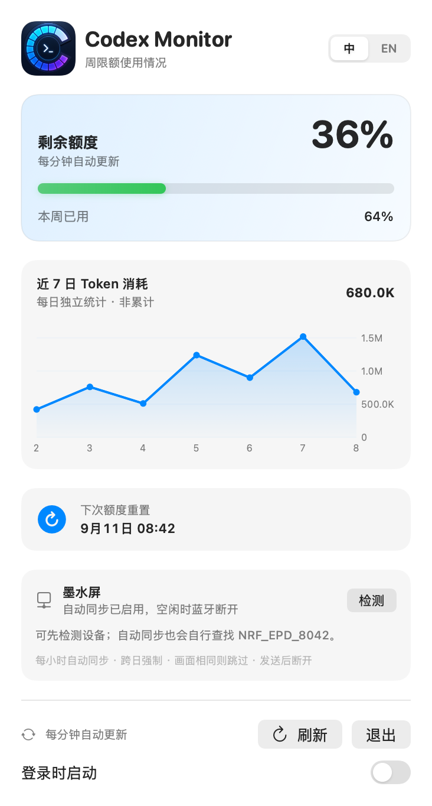
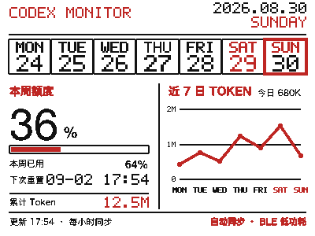

# Codex Monitor

[简体中文](README.zh-CN.md)

Codex Monitor is an unofficial, local-first dashboard for Codex usage. It focuses on
the Mac, with these surfaces:

- a native macOS menu bar app with medium and large WidgetKit widgets;
- a 400 × 300 black/white/red Bluetooth e-paper dashboard for
  `NRF_EPD_8042` hardware.





## What is included

| Component | Data source | Default refresh |
|---|---|---|
| macOS menu | locally launched `codex app-server` | every minute |
| macOS widgets | sanitized App Group snapshot, with a loopback fallback for ad-hoc builds | WidgetKit timeline |
| Bluetooth EPD | frame rendered by the macOS app | hourly check, forced after midnight |

The EPD connection is intentionally short lived. Codex Monitor hashes the
rendered content, skips Bluetooth entirely when the visible data is unchanged,
and otherwise performs `connect → send → disconnect`. A failed connection or
write is retried once.

## Quick start

### macOS app

1. Download the DMG from [Releases](https://github.com/Mintzz666/codex-monitor/releases).
2. Drag **Codex Monitor** to `/Applications`.
3. Make sure the official Codex CLI/app is installed and signed in.
4. Start Codex Monitor. It refreshes locally and offers launch at login.
   Disabling launch at login is remembered across restarts.

Community DMGs are ad-hoc signed unless a maintainer supplies Apple signing and
notarization credentials. If Gatekeeper blocks the first launch, right-click the
app and choose **Open**, or build it from source.

### Bluetooth e-paper dashboard

Power an `NRF_EPD_8042` 4.2-inch 400 × 300 black/white/red display and keep it
within Bluetooth range of the Mac. Grant Bluetooth permission to Codex Monitor.
The app can discover the board automatically; **Probe** is available for a
read-only hardware check, and **Sync now** forces an immediate data check.

See [EPD hardware and protocol guide](docs/setup-epd.md).

## Build from source

Requirements:

- macOS 13 or later;
- a full Xcode installation with a Swift 6.3-capable toolchain;
- the official Codex CLI/app for the live macOS integration test;
- XcodeGen only when regenerating checked-in Xcode projects.

```sh
git clone https://github.com/Mintzz666/codex-monitor.git
cd codex-monitor

make test
make package
make dmg
```

Before signing with an Apple Development team, replace every
`com.example.codexmonitor` and `group.com.example.codexmonitor` identifier with
values unique to your team, then regenerate the projects:

```sh
brew install xcodegen
make xcode-project
```

Full instructions: [macOS build guide](docs/setup-macos.md).

## Data and privacy

On macOS, Codex Monitor launches the locally installed `codex app-server` and
uses `account/read`, `account/rateLimits/read`, and `account/usage/read`.
Authentication and refresh-token handling remain inside Codex. The app does
not read browser cookies or copy Codex credentials.

No analytics, advertising SDK, cloud database, or developer-operated backend is
included. See [architecture and privacy](docs/architecture-and-privacy.md).

## Reproduction map

- [macOS app and widgets](docs/setup-macos.md)
- [Bluetooth EPD dashboard](docs/setup-epd.md)
- [architecture, data flow, and privacy](docs/architecture-and-privacy.md)
- [release process](docs/releasing.md)
- [contributing](CONTRIBUTING.md)
- [security policy](SECURITY.md)

## License and attribution

MIT licensed. This project is derived from
[`CMMUU/codex-usage-bar`](https://github.com/CMMUU/codex-usage-bar). The
original copyright notice and MIT terms are preserved in [LICENSE](LICENSE),
with additional attribution in [NOTICE.md](NOTICE.md).

Codex, ChatGPT, OpenAI, Apple, iPhone, and the referenced display hardware are
trademarks of their respective owners. This community project is not affiliated
with or endorsed by OpenAI, Apple, or the hardware vendor.
