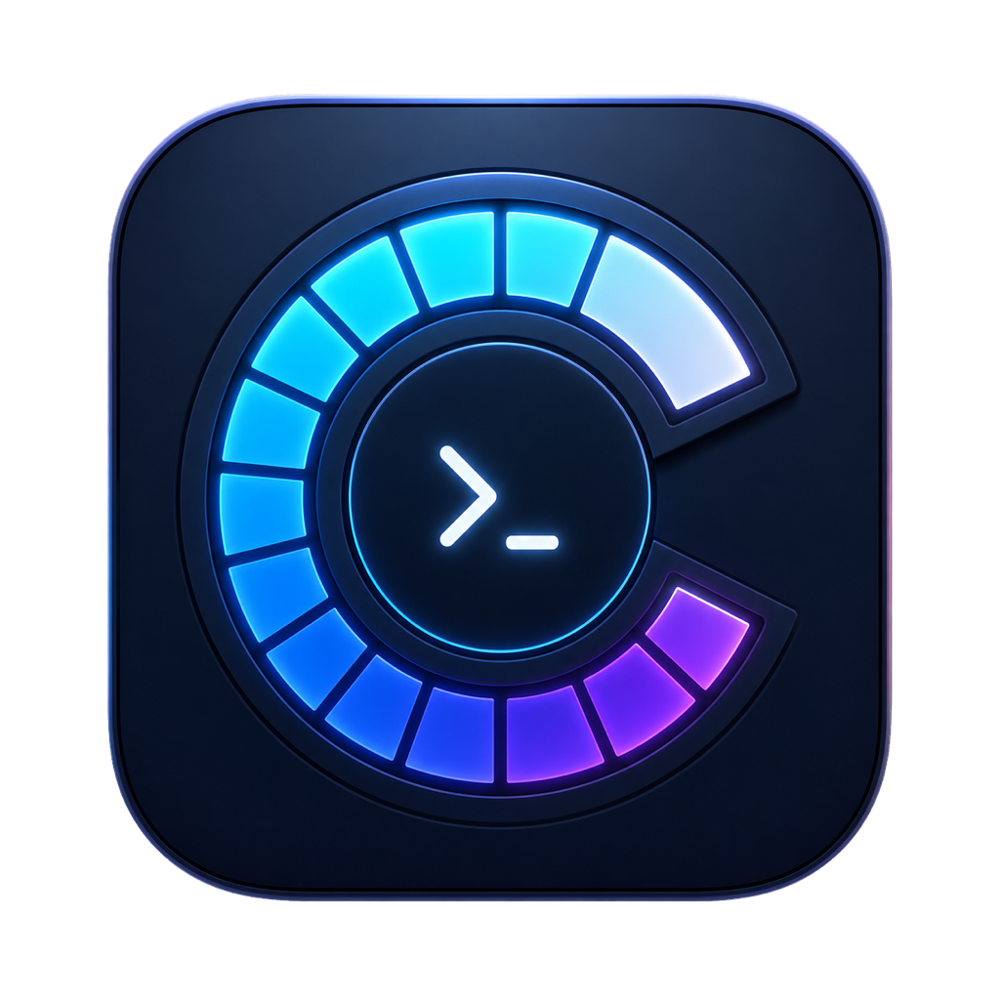

<div align="center">
  
  <h1>Codex Monitor</h1>
  <p><strong>Your Codex usage, one glance away.</strong></p>
  <p>A native macOS menu bar app, desktop widgets and managed ChatGPT appearance.</p>
  <p>
    <a href="https://github.com/Mintzz666/codex-monitor/releases/latest"></a>
    
    
    <a href="LICENSE"></a>
  </p>
  <p><a href="README.zh-CN.md">简体中文</a> · <a href="README.md">English</a></p>
  <p><a href="https://github.com/Mintzz666/codex-monitor/releases/latest"><strong>Download for macOS</strong></a> · <a href="docs/setup-macos.md">Build guide</a> · <a href="NOTICE.md">Authors & credits</a></p>
  <p>Created and maintained by <a href="https://github.com/Mintzz666">Mintzz</a>.</p>
</div>

---

## A quieter way to keep track

See your remaining quota and reset time from the menu bar. Check recent Token
activity on your desktop, and manage the customized ChatGPT appearance from
one place. No separate Badge installation is required.

| At a glance | On your desktop | Inside ChatGPT |
|---|---|---|
| Remaining quota, reset time and recent Token activity | Medium and large WidgetKit widgets | Folder colors, Recent thread matching, Token shades and reset labels |

<p align="center"></p>
<p align="center"><sub>Preview with example usage values. The app supports English and Simplified Chinese.</sub></p>

## Sidebar colors that stay with your projects

Assign one of seven colors to a project folder. Its conversations inherit that
color, with five shades indicating cumulative Token ranges. Uniquely matched
threads keep their project color in Recent; unresolved matches stay neutral.


*Illustration based on the current color rules. All names are fictional; no
real chats, file paths, account details or quota values are shown.*

## Get started

1. Download the **universal DMG** from [the latest release](https://github.com/Mintzz666/codex-monitor/releases/latest).
2. Drag **Codex Monitor** to **Applications**.
3. Make sure the official Codex CLI/app is installed and signed in, then open Monitor.
4. For the optional appearance integration, open **ChatGPT Appearance** in Monitor
   and choose **Install / Update / Repair**. ChatGPT’s bundled Node.js runtime is required.

**macOS 13 or later · Apple Silicon and Intel.** Community builds are ad-hoc
signed. If macOS blocks the first launch, use its **Open** / **Open Anyway**
flow or build from source. Windows is a future port; the upstream Windows
reference files do not constitute a Windows Monitor release.

Monitor remembers your launch-at-login preference. If ChatGPT’s local interface
is disconnected, fully quit ChatGPT with ⌘Q and reopen it from its usual icon.
Monitor does not close ChatGPT for you.

## What runs locally

| Component | Source | Refresh |
|---|---|---|
| Menu bar app | Local `codex app-server` | About once a minute after a successful read |
| Desktop widgets | Sanitized App Group snapshot; loopback fallback for supported builds | WidgetKit timeline |
| ChatGPT appearance | The same Monitor quota snapshot; included local helper | About every 5 seconds |
| Global reset radar | Public [codex-reset.com](https://codex-reset.com/) records and forecast | About every 5 minutes while Monitor runs |

Monitor is the quota collector. The managed appearance helper reuses its local
snapshot. The full fork source is retained in
[ThirdParty/codex-usage-badge](ThirdParty/codex-usage-badge); it is not copied
into the installed application.

Reset markers describe community-recorded global events, not confirmation that
your account received a reset. Forecasts show the source’s raw **24h / 48h**
probabilities and confidence. Stale or failed forecasts hide their percentages.

## Build from source

Requirements:

- macOS 13 or later;
- a full Xcode installation with a Swift 6.3-capable toolchain;
- the official Codex CLI/app for the live macOS integration test;
- XcodeGen only when regenerating checked-in Xcode projects.

```sh
git clone https://github.com/Mintzz666/codex-monitor.git
cd codex-monitor

make test
make package
make dmg
```

Before signing with an Apple Development team, replace every
`com.example.codexmonitor` and `group.com.example.codexmonitor` identifier with
values unique to your team, then regenerate the projects:

```sh
brew install xcodegen
make xcode-project
```

Full instructions: [macOS build guide](docs/setup-macos.md).

## Privacy and documentation

No analytics, ads, cloud database or Monitor-operated backend. Usage is read
through the local Codex app-server; credentials remain under Codex’s control.
Account-change checks read the local authentication file to derive an identity
fingerprint, without using access or refresh token values. Public reset-data
requests send no Codex credentials or quota data.

[Architecture & privacy](docs/architecture-and-privacy.md) ·
[Release process](docs/releasing.md) ·
[Windows porting handoff](docs/windows-porting-handoff.md) ·
[Contributing](CONTRIBUTING.md) · [Security](SECURITY.md)

## Authors and license

**[Mintzz](https://github.com/Mintzz666)** — primary author and maintainer of the
current Codex Monitor integration and customizations.

The original menu bar foundation is by
[CMMUU](https://github.com/CMMUU/codex-usage-bar). The appearance helper derives
from [jaykinhoo9’s Codex Usage Badge](https://github.com/jaykinhoo9/codex-usage-badge).
Their upstream contributions and MIT notices are preserved.

[MIT License](LICENSE) · [Full attribution](NOTICE.md)

Unofficial community project; not affiliated with or endorsed by OpenAI or Apple.
