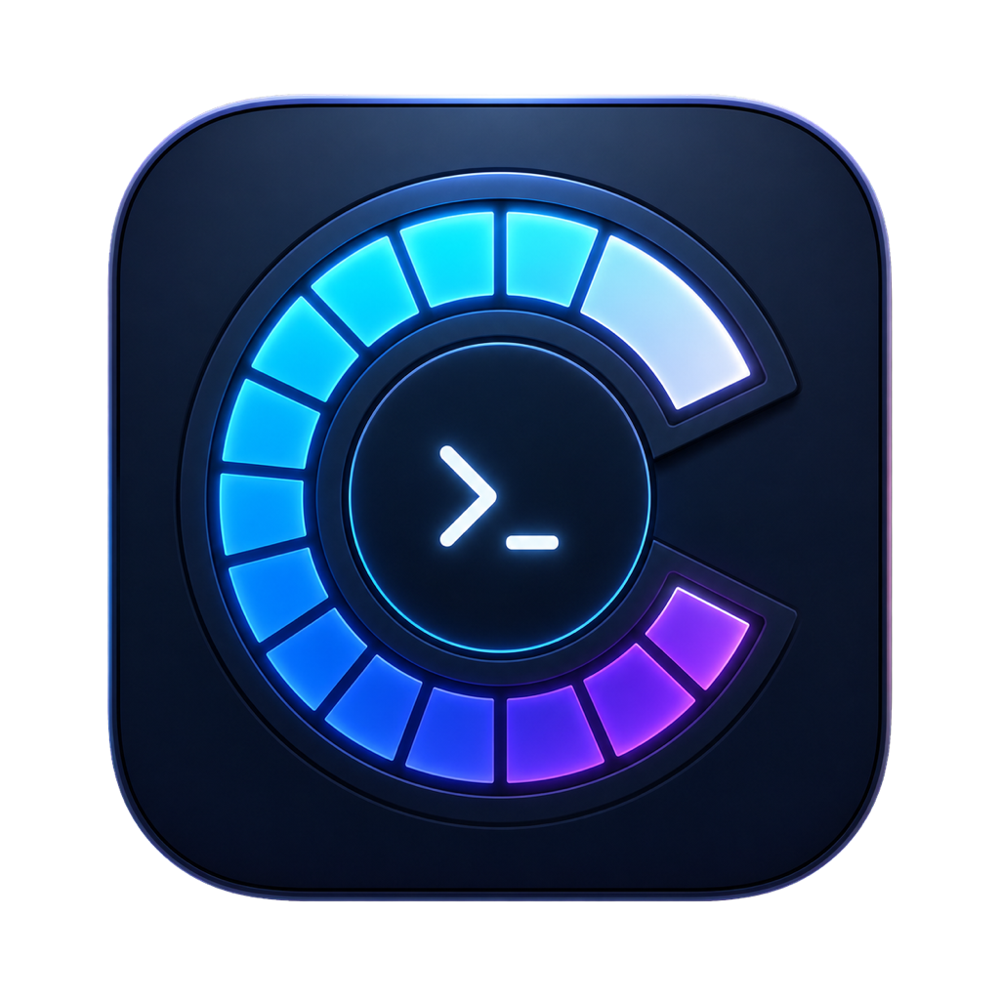
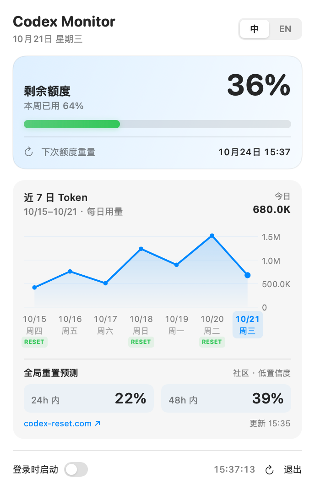
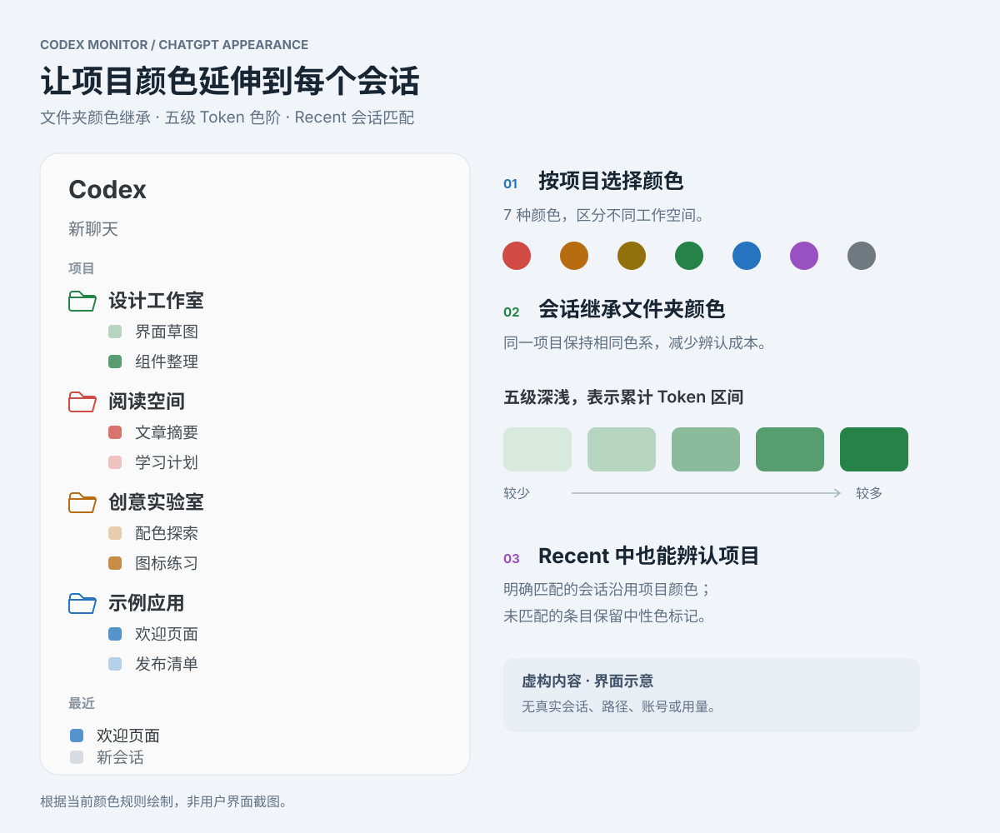

<div align="center">
  
  <h1>Codex Monitor</h1>
  <p><strong>Codex 用量，抬眼就知道。</strong></p>
  <p>原生 macOS 菜单栏 · 桌面小组件 · 统一管理 ChatGPT 外观增强</p>
  <p>
    <a href="https://github.com/Mintzz666/codex-monitor/releases/latest"></a>
    
    
    <a href="LICENSE"></a>
  </p>
  <p><a href="README.zh-CN.md">简体中文</a> · <a href="README.md">English</a></p>
  <p><a href="https://github.com/Mintzz666/codex-monitor/releases/latest"><strong>下载 macOS 版</strong></a> · <a href="docs/setup-macos.md">构建指南</a> · <a href="NOTICE.md">作者与来源</a></p>
  <p>由 <a href="https://github.com/Mintzz666">Mintzz</a> 主导开发与维护。</p>
</div>

---

## 1.5 更新

- 中英文重置倒计时。
- 登录恢复窗口自动加载外观，并保护正在使用的窗口和前台焦点。
- 显示启动助手健康状态；短时复用检查结果，避免重复启动检查进程。
- 精简运行包和共享额度入口；更新失败时恢复旧版，保留本机设置。

验证范围和限制见 [1.5.0 发布说明](docs/release-notes/v1.5.0.md)。

## 随手查看，统一管理

在菜单栏查看剩余额度和重置时间，在桌面了解近期 Token 用量，
从同一入口管理定制版 ChatGPT 外观增强。无需再单独安装 Badge。

| 菜单栏一览 | 桌面常驻 | ChatGPT 外观增强 |
|---|---|---|
| 剩余额度、重置时间、近期 Token 用量 | 中型与大型 WidgetKit 小组件 | 文件夹颜色继承、Recent 会话匹配、Token 色阶与重置标签 |

<p align="center"></p>
<p align="center"><sub>用量为演示数据。应用支持简体中文和 English。</sub></p>

## 侧边栏颜色：项目与会话一眼对应

项目文件夹可选择七种颜色，会话自动继承所属项目的色系，并用五级深浅表示
累计 Token 区间。在 Recent 中，能唯一匹配到项目的会话也会延续项目颜色；
无法明确匹配的条目保持中性色。



*根据当前颜色规则绘制的界面示意。所有名称均为虚构，不包含真实聊天、文件路径、
账号信息或额度数值。*

## 开始使用

1. 从[最新发布页](https://github.com/Mintzz666/codex-monitor/releases/latest)下载 **通用 DMG**。
2. 将 **Codex Monitor** 拖入 **Applications（应用程序）**。
3. 确认官方 Codex CLI/App 已安装并登录，然后打开 Monitor。
4. 若需要外观增强，在 Monitor 的 **ChatGPT 外观增强** 中选择 **安装 / 更新 / 修复**。
   该功能需要 ChatGPT 自带的 Node.js 运行时。

**macOS 13+ · 同时支持 Apple Silicon 与 Intel。** 社区构建使用临时签名；
首次启动受系统拦截时，按 macOS 的“打开”或“仍要打开”流程处理，也可自行构建。
Windows 仍属后续移植方向；仓库中的上游 Windows 参考代码不代表已发布 Windows 版。

应用会记住登录启动偏好。外观组件安装一次后，其启动助手会随登录常驻，
处理先于助手启动的登录恢复窗口，以及一分钟内尚未操作的慢启动窗口；
必要时温和重开该窗口以加载外观，后台恢复保持在后台。已经开始操作的窗口会被跳过。
若 ChatGPT 的本地接口仍未连接，请用 ⌘Q 完全退出，再从原来的图标重新打开，无需重新安装组件。

## 本地组件与数据流

| 组件 | 数据来源 | 刷新方式 |
|---|---|---|
| 菜单栏 | 本机 `codex app-server` | 成功读取后约每分钟 |
| 桌面小组件 | 脱敏 App Group 快照；支持的构建可回退到本机回环接口 | WidgetKit 时间线 |
| ChatGPT 外观增强 | 同一份 Monitor 额度快照；内置本地后台助手 | 约每 5 秒 |
| 全局重置雷达 | [codex-reset.com](https://codex-reset.com/) 的公开记录与预测 | Monitor 运行时约每 5 分钟 |

额度由 Monitor 统一采集，外观助手复用本地快照。完整 fork 源码保存在
[ThirdParty/codex-usage-badge](ThirdParty/codex-usage-badge)，不会一并复制进安装后的应用。

重置标记表示社区记录中的全局事件，不代表你的账号已经重置。预测展示来源提供的
**24h / 48h** 原始概率和置信度；数据过期或读取失败时隐藏百分比。

## 从源码构建

需要：

- macOS 13 或更高版本；
- 完整 Xcode，以及支持 Swift 6.3 的工具链；
- 运行真实 macOS 数据测试时，需要官方 Codex CLI/App；
- 只有重新生成已检入的 Xcode 工程时才需要 XcodeGen。

```sh
git clone https://github.com/Mintzz666/codex-monitor.git
cd codex-monitor

make test
make package
make dmg
```

使用 Apple Development Team 签名前，请把
`com.example.codexmonitor` 和 `group.com.example.codexmonitor`
全部替换成属于你团队的唯一标识，然后重新生成工程：

```sh
brew install xcodegen
make xcode-project
```

完整步骤：[macOS 构建指南](docs/setup-macos.md)。

## 隐私与文档

项目不包含统计分析、广告、云数据库或 Monitor 自营后端。用量通过本机 Codex
app-server 读取，登录凭据由 Codex 管理。账号切换检查会读取本地认证文件以生成
身份指纹，不使用访问令牌或刷新令牌的值。公开重置数据请求不携带 Codex 凭据或额度数据。

[架构与隐私](docs/architecture-and-privacy.md) ·
[发布流程](docs/releasing.md) ·
[Windows 移植交接](docs/windows-porting-handoff.md) ·
[参与贡献](CONTRIBUTING.md) · [安全策略](SECURITY.md)

## 作者与许可

**[Mintzz](https://github.com/Mintzz666)**：当前 Codex Monitor 整合与定制版本的
主要作者和维护者。

原始菜单栏基础来自 [CMMUU/codex-usage-bar](https://github.com/CMMUU/codex-usage-bar)，
外观增强基础来自 [jaykinhoo9/codex-usage-badge](https://github.com/jaykinhoo9/codex-usage-badge)。
保留两项上游工作的贡献说明和 MIT 版权声明。

[MIT 许可证](LICENSE) · [完整作者与来源说明](NOTICE.md)

本项目是非官方社区项目，与 OpenAI 或 Apple 不存在隶属或背书关系。
