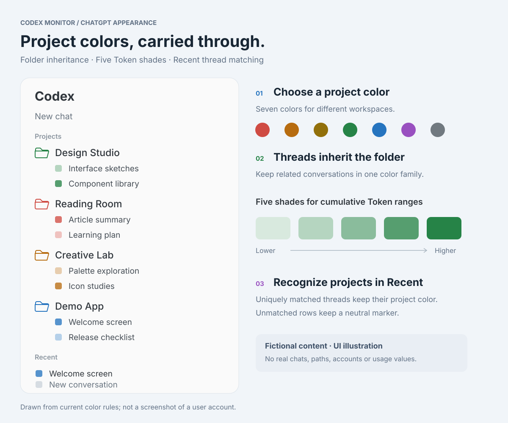

# Codex Monitor 1.4.10

## 侧边栏配色 / Sidebar colors

项目颜色继承、五级 Token 色阶与 Recent 会话匹配。所有名称均为虚构，图中没有真实聊天、路径、账号或用量。
Project color inheritance, five Token shades and Recent thread matching. All names are fictional; no real chats, paths, accounts or usage data are shown.

[查看中文示意图 / Chinese illustration](https://github.com/Mintzz666/codex-monitor/blob/main/docs/images/sidebar-colors-demo-zh-CN.svg)

## 中文

- 精简应用打包内容：PNG 原图保留在源码，应用使用 ICNS 图标。
- Badge 仅携带运行、诊断和许可文件；开发备份、补丁和回退脚本继续保留在仓库。
- 同步收紧安装清单和固定哈希校验，避免旧开发文件进入后续安装。
- CI 使用项目版本，并增加 Badge 与打包回归检查。

本地双架构候选包 Build 47 相比公开 1.4.9：应用文件总长度减少 **15.65%**，
DMG 减少 **21.70%**。这是磁盘体积变化；内存、CPU 或能耗收益尚未测量。
历史用户资料不会自动清理，菜单栏、小组件和定制 agent 内容保留。

## English

- Keep the source PNG in the repository and ship the ICNS application icon.
- Package only Badge runtime, diagnostics and license files; preserve development
  backups, patches and rollback scripts in the source tree.
- Align installation and checksum manifests with the runtime-only package.
- Read the CI version from project settings and add Badge/packaging regression checks.

The local universal Build 47 candidate reduces application file bytes by
**15.65%** and DMG size by **21.70%** versus public 1.4.9. These are disk-size
measurements; memory, CPU and energy improvements have not been measured.
Existing user files are preserved, along with the menu bar, widgets and pinned
customized agent.

Verified locally: Swift verifier (80 checks), Badge tests (7), packaging tests (5),
universal app/widget architectures, signatures, DMG checksum and read-only
installer preflight. The new package has not been installed in place of the
current app. Primary author and maintainer: [Mintzz](https://github.com/Mintzz666).
Upstream MIT credits are preserved in [NOTICE](https://github.com/Mintzz666/codex-monitor/blob/main/NOTICE.md).
