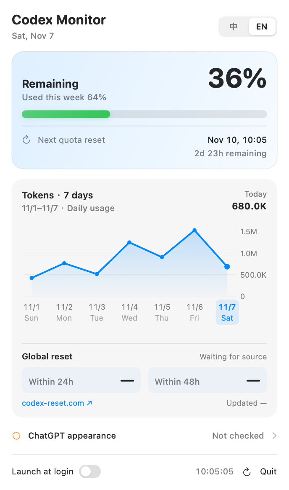
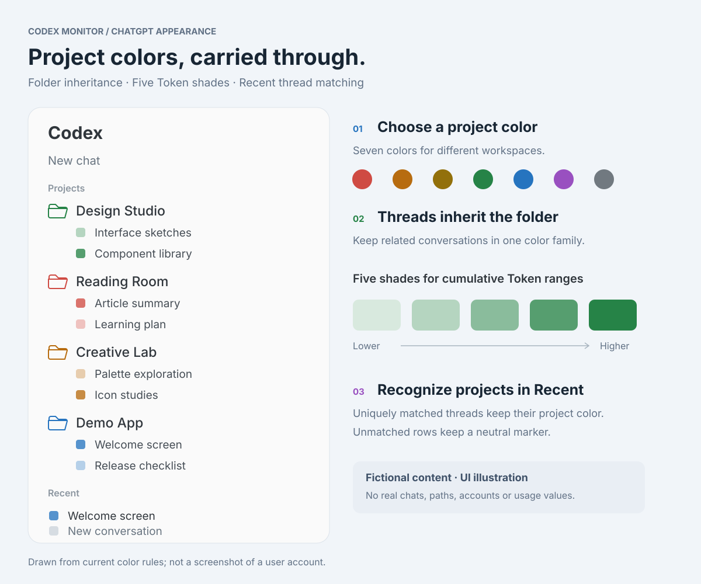

<div align="center">

# Codex Monitor 1.4.9

**菜单栏、桌面小组件与 ChatGPT 外观，一个入口管理。**

**Your menu bar, desktop widgets and ChatGPT appearance, managed together.**

macOS 13+ · Apple Silicon + Intel · Build 46 · MIT

[下载通用 DMG / Download](https://github.com/Mintzz666/codex-monitor/releases/download/v1.4.9/Codex-Monitor-v1.4.9-universal.dmg) · [中文说明](https://github.com/Mintzz666/codex-monitor/blob/main/README.zh-CN.md) · [English guide](https://github.com/Mintzz666/codex-monitor#readme)

</div>

---

<table>
<tr><th>简体中文</th><th>English</th></tr>
<tr>
<td></td>
<td></td>
</tr>
</table>

*用量为演示数据 / Usage values are examples.*

## 侧边栏配色 / Sidebar colors



项目颜色继承、五级 Token 色阶与 Recent 会话匹配。所有名称均为虚构，图中没有真实聊天、路径、账号或用量。
Project color inheritance, five Token shades and Recent thread matching. All names are fictional; no real chats, paths, accounts or usage data are shown.

[查看中文示意图 / Chinese illustration](https://github.com/Mintzz666/codex-monitor/blob/main/docs/images/sidebar-colors-demo-zh-CN.svg)

## 中文

### 本次更新

- **统一外观管理**：菜单中显示 ChatGPT 外观连接状态，独立管理窗口提供安装、更新和修复。
- **统一额度来源**：内置 Mintzz 定制 Badge，复用 Monitor 的本地共享额度；后台助手不再单独采集额度。
- **可核验的连接状态**：区分应用签名、固定版本哈希、额度桥、后台服务与 ChatGPT 页面注入。
- **本地诊断**：包含脱敏链路检查，以及代理、DNS、路由和 HTTPS 连通性诊断脚本。
- 保留菜单栏额度、重置时间、Token 图表、中型/大型桌面小组件和社区全局重置雷达。

### 安装

1. 下载下方的 `Codex-Monitor-v1.4.9-universal.dmg`，将应用拖入 **Applications**。
2. 确认官方 Codex CLI/App 已安装并登录，然后打开 Monitor。
3. 需要外观增强时，从 Monitor 的“ChatGPT 外观增强”选择“安装 / 更新 / 修复”。该功能使用 ChatGPT 自带的 Node.js 运行时。

当前仅支持 **macOS**。若 ChatGPT 本地接口未连接，请用 ⌘Q 完全退出后从原图标重新打开；Monitor 不会自动关闭 ChatGPT。社区构建为临时签名，未进行 Apple 公证；首次启动受拦截时使用系统“打开”或“仍要打开”流程，或自行构建。

## English

### What’s new

- **One place for appearance**: a compact ChatGPT status row and a dedicated window for installation, updates and repair.
- **One quota source**: the included Mintzz-customized Badge reads Monitor’s local snapshot instead of collecting quota separately.
- **Verifiable status**: separate checks for the app signature, pinned build hashes, quota bridge, background helper and ChatGPT injection.
- **Local diagnostics**: sanitized chain checks plus scripts for proxy, DNS, route and HTTPS connectivity.
- Retains menu bar quota and reset time, Token charts, medium/large desktop widgets and the community global-reset radar.

### Install

1. Download `Codex-Monitor-v1.4.9-universal.dmg` below and drag the app to **Applications**.
2. Make sure the official Codex CLI/app is installed and signed in, then open Monitor.
3. For optional appearance features, choose **Install / Update / Repair** in **ChatGPT Appearance**. This uses ChatGPT’s bundled Node.js runtime.

This release supports **macOS only**. If ChatGPT’s local interface is disconnected, quit it with ⌘Q and reopen it from its usual icon. Monitor does not quit ChatGPT automatically. This community build is ad-hoc signed and is not Apple-notarized; use the system’s Open / Open Anyway flow if needed, or build from source.

## 校验下载 / Verify your download

```sh
shasum -a 256 Codex-Monitor-v1.4.9-universal.dmg
```

```text
281b2d8dad44f221544672ff22a7b8ca5d2c03b69778853f0cbdb9f52cdf8388
```

The matching `.sha256` file is attached below. / 下方附有对应校验文件。

## 作者与来源 / Authors & credits

**[Mintzz](https://github.com/Mintzz666)** — 当前整合与定制版本的主要作者、维护者 / primary author and maintainer of the current integration and customizations.

原始菜单栏基础 / original menu bar foundation: [CMMUU/codex-usage-bar](https://github.com/CMMUU/codex-usage-bar).
外观增强基础 / appearance foundation: [jaykinhoo9/codex-usage-badge](https://github.com/jaykinhoo9/codex-usage-badge).

MIT licenses and upstream copyright notices are preserved. / 保留 MIT 许可和上游版权声明。

[架构与隐私 / Architecture & privacy](https://github.com/Mintzz666/codex-monitor/blob/main/docs/architecture-and-privacy.md) · [完整归属 / Attribution](https://github.com/Mintzz666/codex-monitor/blob/main/NOTICE.md) · [Windows 移植说明 / Porting handoff](https://github.com/Mintzz666/codex-monitor/blob/main/docs/windows-porting-handoff.md)

Global-reset forecasts are community estimates, not guarantees for an individual account. A native Windows Monitor release and the personal `codex-monitor-health` skill are not included in this installer. / 全局重置预测属于社区估计，不保证个人账号重置；本安装包不包含原生 Windows 版或个人安装的 `codex-monitor-health` Skill。
